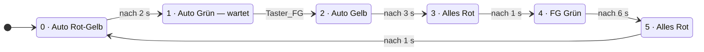

# Fussgänger-Bedarfsampel (SPS / Structured Text)

Bedarfsampel für einen Fussgängerüberweg, programmiert in **Structured Text nach IEC 61131-3** mit dem OpenPLC Editor.

Autos haben im Normalfall Grün. Drückt ein Fussgänger den Anforderungstaster, läuft die Umschaltung ab und der Automat kehrt danach in die Autofreigabe zurück.

Anforderungen und Variablenliste waren vorgegeben. Logik und Programm habe ich selbst entworfen und geschrieben.

---

## Funktion

| Schritt | Auto | Fussgänger | Dauer | Übergang |
|--------:|------|------------|:-----:|---|
| 0 | Rot-Gelb | Rot | 2 s | Zeit |
| 1 | Grün | Rot | unbegrenzt | **Taster** |
| 2 | Gelb | Rot | 3 s | Zeit |
| 3 | Rot | Rot | 1 s | Zeit |
| 4 | Rot | **Grün** | 6 s | Zeit |
| 5 | Rot | Rot | 1 s | Zeit |

Nach Schritt 5 beginnt der Zyklus wieder bei 0.

---

## Zustandsdiagramm



**Der Unterschied zur reinen Zeitampel liegt in Schritt 1.** Alle anderen Übergänge sind zeitgesteuert; dieser eine wartet auf ein Ereignis. Der Automat bleibt beliebig lange in Schritt 1 stehen, solange niemand drückt.

---

## Signalliste

Das Projekt ist für den **OpenPLC-Simulator** angelegt, ein Pin-Mapping auf physische Hardware ist nicht hinterlegt.

| Variable | Typ | Richtung | Bedeutung |
|---|---|---|---|
| `Taster_FG` | `BOOL` | **Eingang** | Anforderungstaster Fussgänger |
| `Auto_Rot` | `BOOL` | Ausgang | Rot Fahrbahn |
| `Auto_Gelb` | `BOOL` | Ausgang | Gelb Fahrbahn |
| `Auto_Gruen` | `BOOL` | Ausgang | Grün Fahrbahn |
| `FG_Rot` | `BOOL` | Ausgang | Rot Fussgänger |
| `FG_Gruen` | `BOOL` | Ausgang | Grün Fussgänger |
| `Schritt` | `INT` | intern | aktuelle Phase 0–5 |
| `Schritt_alt` | `INT` | intern | Schritt des vorherigen Zyklus, für den Timer-Reset |
| `T_Zeit` | `TIME` | intern | Dauer der aktuellen Phase |
| `T1` | `TON` | intern | Phasentimer |

**Bei Zuordnung auf echte Hardware:** `Taster_FG` auf einen digitalen Eingang (`%IX0.0`), die fünf Lampen auf digitale Ausgänge (`%QX0.0` bis `%QX0.4`).

---

## Technik

- **Zustandsautomat** über `CASE Schritt OF ... END_CASE`
- **Grundstellung auf sicheren Zustand:** Zu Beginn jedes Zyklus stehen alle Lampen auf Rot, danach setzt die aktive Phase nur ihre Abweichungen.
- **Sicherheitsverriegelung:** Sind Auto- und Fussgängerampel gleichzeitig grün, werden beide Grün-Signale sofort abgeschaltet.

### Timer-Reset über den Schrittwechsel

```pascal
T1(IN := (Schritt = Schritt_alt), PT := T_Zeit);
Schritt_alt := Schritt;
```

Der Timer läuft nur, solange der Schritt unverändert bleibt. Sobald der Automat weiterschaltet, ist `Schritt <> Schritt_alt`. `IN` wird für einen Zyklus `FALSE` und der Timer startet in der neuen Phase sauber bei null.

Das löst ein Problem, das bei einem Timer mit Selbstreset (`IN := NOT T1.Q`) nicht so klar zu sehen ist: Der Reset hängt hier am Zustandswechsel selbst, nicht am Ablaufen der Zeit. Genau deshalb funktioniert Schritt 1, der gar keine Zeitbedingung hat, sondern auf den Taster wartet.

---

## Bekannte Vereinfachungen

Bewusst nicht umgesetzt, für eine reale Anlage aber nötig:

- **Keine Mindestgrünzeit für Fahrzeuge.** Wird der Taster sofort nach Beginn von Schritt 1 gedrückt, schaltet die Ampel unmittelbar weiter. Eine echte Bedarfsampel hält eine Mindestfreigabezeit ein, bevor sie auf Anforderung reagiert.
- **Keine gespeicherte Anforderung.** Ein Tastendruck während der Schritte 2 bis 5 verfällt. In der Praxis wird die Anforderung gespeichert und im nächsten Grünabschnitt bedient.
- **Verriegelung schaltet nur ab.** Löst sie aus, werden beide Grün-Signale gelöscht, aber kein Rot gesetzt. In Schritt 1 wäre die Autoampel dann dunkel. Eine reale Anlage würde in einen definierten sicheren Zustand gehen, z. B. Gelbblinken. Im Normalbetrieb kann die Verriegelung nicht auslösen, weil kein Schritt beide Grün setzt.
- **Keine Flankenauswertung des Tasters.** Bleibt der Taster gedrückt, bis der Ablauf wieder in Schritt 1 ankommt, schaltet der Automat sofort erneut weiter. Die Autos haben dann nur einen SPS-Zyklus lang Grün. Mit `R_TRIG` oder einer Mindestgrünzeit liesse sich das verhindern.

---

## Testplan

Testfälle für den OpenPLC-Simulator: Variablen im Debugger beobachten bzw. setzen.

| Nr. | Testfall | Erwartetes Verhalten |
|---:|---|---|
| 1 | Kaltstart | `Schritt = 0`, Auto Rot und Gelb, Fussgänger Rot |
| 2 | Nach 2 s | Wechsel auf `Schritt = 1`, Auto Grün |
| 3 | Schritt 1 ohne Tastendruck | bleibt beliebig lange in Grün, kein Zeitablauf |
| 4 | `Taster_FG` kurz auf TRUE | Wechsel auf `Schritt = 2`, Auto Gelb |
| 5 | Schritt 3 | alles Rot, Dauer 1 s |
| 6 | Schritt 4 | Fussgänger Grün, Auto Rot, Dauer 6 s |
| 7 | Schritt 5 | alles Rot, Dauer 1 s, danach zurück auf `Schritt = 0` |
| 8 | Ein Anforderungszyklus ab Tastendruck | 3 + 1 + 6 + 1 + 2 = ca. 13 s bis wieder Auto Grün |
| 9 | Über den ganzen Ablauf | zu keinem Zeitpunkt `Auto_Gruen AND FG_Gruen` |
| 10 | Verriegelung auslösen: in Schritt 1 vorübergehend `FG_Gruen := TRUE;` ergänzen | beide Grün werden zurückgesetzt, Autoampel dunkel (siehe Bekannte Vereinfachungen) |
| 11 | `Taster_FG` in Schritt 2 bis 5 kurz auf TRUE und vor Schritt 1 wieder FALSE | Ablauf läuft normal weiter, die Anforderung verfällt (bekannte Schwäche) |
| 12 | `Taster_FG` gedrückt halten, bis Schritt 1 wieder erreicht ist | Schritt 1 wird sofort wieder verlassen, Auto nur einen Zyklus Grün (bekannte Schwäche) |

Testfall 10 prüft die Verriegelung selbst, nicht nur den Normalbetrieb. Ausgelöst wird sie über eine vorübergehende Codeänderung statt über Forcen im Debugger, weil die Grundstellung am Zyklusanfang die Ausgänge in jedem Zyklus neu setzt. Nach dem Test die Zeile wieder entfernen.

Die Testfälle 11 und 12 zeigen die zwei bekannten Schwächen: kein Speicher für die Anforderung und keine Flankenauswertung (siehe Bekannte Vereinfachungen).

---

## Ausführen

1. Projekt im OpenPLC Editor öffnen
2. Kompilieren und Simulation starten
3. Variablen `Schritt`, `Auto_*`, `FG_*` und `Taster_FG` in den Debugger holen
4. In Schritt 1 `Taster_FG` auf `TRUE` setzen, um die Anforderung auszulösen

**Beim Testen beachten:** `Taster_FG` nach dem Auslösen wieder auf `FALSE` setzen. Bleibt er `TRUE`, löst er in Schritt 1 sofort erneut aus (Testfall 12).

---

## Hintergrund

Übungsprojekt im Rahmen meiner Vorbereitung auf die Industrieautomation. Erstes vollständig eigenständig entworfenes Programm nach vorgegebener Spezifikation.

Verwandtes Projekt: [ampelsteuerung](https://github.com/kevin-wiesner/ampelsteuerung): Kreuzung mit zwei verriegelten Fahrtrichtungen, rein zeitgesteuert.
