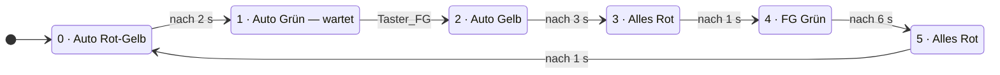

# Fussgänger-Bedarfsampel (SPS / Structured Text)

Bedarfsampel für einen Fussgängerüberweg, programmiert in **Structured Text nach IEC 61131-3** mit dem OpenPLC Editor.

Autos haben im Normalfall Grün. Drückt ein Fussgänger den Anforderungstaster, läuft die Umschaltung ab und der Automat kehrt danach in die Autofreigabe zurück.

**Dieses Programm habe ich eigenständig nach Spezifikation entworfen und implementiert** — Anforderungen und Variablenliste waren vorgegeben, Logik und Umsetzung stammen von mir.

---

## Funktion

| Schritt | Auto | Fussgänger | Dauer | Übergang |
|--------:|------|------------|:-----:|---|
| 0 | Rot-Gelb | Rot | 2 s | Zeit |
| 1 | Grün | Rot | unbegrenzt | **Taster** |
| 2 | Gelb | Rot | 3 s | Zeit |
| 3 | Rot | Rot | 1 s | Zeit |
| 4 | Rot | **Grün** | 6 s | Zeit |
| 5 | Rot | Rot | 1 s | Zeit |

Nach Schritt 5 beginnt der Zyklus wieder bei 0.

---

## Zustandsdiagramm



**Der Unterschied zur reinen Zeitampel liegt in Schritt 1.** Alle anderen Übergänge sind zeitgesteuert; dieser eine wartet auf ein Ereignis. Der Automat bleibt beliebig lange in Schritt 1 stehen, solange niemand drückt.

---

## Signalliste

Das Projekt läuft im **OpenPLC-Simulator**, ein Pin-Mapping auf physische Hardware ist nicht hinterlegt.

| Variable | Typ | Richtung | Bedeutung |
|---|---|---|---|
| `Taster_FG` | `BOOL` | **Eingang** | Anforderungstaster Fussgänger |
| `Auto_Rot` | `BOOL` | Ausgang | Rot Fahrbahn |
| `Auto_Gelb` | `BOOL` | Ausgang | Gelb Fahrbahn |
| `Auto_Gruen` | `BOOL` | Ausgang | Grün Fahrbahn |
| `FG_Rot` | `BOOL` | Ausgang | Rot Fussgänger |
| `FG_Gruen` | `BOOL` | Ausgang | Grün Fussgänger |
| `Schritt` | `INT` | intern | aktuelle Phase 0–5 |
| `Schritt_alt` | `INT` | intern | Schritt des vorherigen Zyklus, für den Timer-Reset |
| `T_Zeit` | `TIME` | intern | Dauer der aktuellen Phase |
| `T1` | `TON` | intern | Phasentimer |

**Bei Zuordnung auf echte Hardware:** `Taster_FG` auf einen digitalen Eingang (`%IX0.0`), die fünf Lampen auf digitale Ausgänge (`%QX0.0` bis `%QX0.4`).

---

## Technik

- **Zustandsautomat** über `CASE Schritt OF ... END_CASE`
- **Grundstellung auf sicheren Zustand:** Zu Beginn jedes Zyklus stehen alle Lampen auf Rot, danach setzt die aktive Phase nur ihre Abweichungen.
- **Sicherheitsverriegelung:** Wären je beide Richtungen gleichzeitig grün, werden beide sofort abgeschaltet.

### Timer-Reset über den Schrittwechsel

```pascal
T1(IN := (Schritt = Schritt_alt), PT := T_Zeit);
Schritt_alt := Schritt;
```

Der Timer läuft nur, solange der Schritt unverändert bleibt. Sobald der Automat weiterschaltet, ist `Schritt <> Schritt_alt` — `IN` wird für einen Zyklus `FALSE` und der Timer startet in der neuen Phase sauber bei null.

Das löst ein Problem, das bei einem Timer mit Selbstreset (`IN := NOT T1.Q`) nicht so klar zu sehen ist: Der Reset hängt hier am Zustandswechsel selbst, nicht am Ablaufen der Zeit. Genau deshalb funktioniert Schritt 1, der gar keine Zeitbedingung hat, sondern auf den Taster wartet.

---

## Bekannte Vereinfachungen

Bewusst nicht umgesetzt, für eine reale Anlage aber nötig:

- **Keine Mindestgrünzeit für Fahrzeuge.** Wird der Taster sofort nach Beginn von Schritt 1 gedrückt, schaltet die Ampel unmittelbar weiter. Eine echte Bedarfsampel hält eine Mindestfreigabezeit ein, bevor sie auf Anforderung reagiert.
- **Keine gespeicherte Anforderung.** Ein Tastendruck während der Schritte 2 bis 5 verfällt. In der Praxis wird die Anforderung gespeichert und im nächsten Grünabschnitt bedient.
- **Keine Flankenauswertung des Tasters.** In dieser Logik unkritisch, weil in Schritt 1 nur der Pegel abgefragt wird. Bei einer gespeicherten Anforderung wäre `R_TRIG` nötig.

---

## Prüfprotokoll

Getestet im OpenPLC-Simulator, Variablen im Debugger beobachtet und gesetzt.

| Nr. | Testfall | Erwartetes Verhalten | Ergebnis | Datum |
|---:|---|---|:--:|---|
| 1 | Kaltstart | `Schritt = 0`, Auto Rot und Gelb, Fußgänger Rot | | |
| 2 | Nach 2 s | Wechsel auf `Schritt = 1`, Auto Grün | | |
| 3 | Schritt 1 ohne Tastendruck | bleibt beliebig lange in Grün, kein Zeitablauf | | |
| 4 | `Taster_FG` kurz auf TRUE | Wechsel auf `Schritt = 2`, Auto Gelb | | |
| 5 | Schritt 3 | alles Rot, Dauer 1 s | | |
| 6 | Schritt 4 | Fußgänger Grün, Auto Rot, Dauer 6 s | | |
| 7 | Schritt 5 | alles Rot, Dauer 1 s, danach zurück auf `Schritt = 0` | | |
| 8 | Ein Anforderungszyklus ab Tastendruck | 3 + 1 + 6 + 1 + 2 = 13 s bis wieder Auto Grün | | |
| 9 | Über den ganzen Ablauf | zu keinem Zeitpunkt `Auto_Gruen AND FG_Gruen` | | |
| 10 | Verriegelung erzwingen: `FG_Gruen` im Debugger auf TRUE forcen, während Auto grün ist | beide Grün werden zurückgesetzt | | |
| 11 | `Taster_FG` während Schritt 2 bis 5 dauerhaft TRUE | Ablauf läuft normal weiter, keine Doppelauslösung | | |
| 12 | `Taster_FG` sehr kurz antippen (unter einem Zyklus) | siehe Bekannte Vereinfachungen — Anforderung kann verloren gehen | | |

Testfall 10 prüft die Verriegelung selbst, nicht nur den Normalbetrieb.

Testfall 12 ist bewusst als bekannte Schwäche mit aufgenommen: Es gibt keinen Speicher für die Anforderung, der Taster wird nur im Zustand 1 abgefragt. Ein Protokoll, das nur die funktionierenden Fälle listet, sagt weniger aus als eines, das die Grenzen mit benennt.

---

## Ausführen

1. Projekt im OpenPLC Editor öffnen
2. Kompilieren und Simulation starten
3. Variablen `Schritt`, `Auto_*`, `FG_*` und `Taster_FG` in den Debugger holen
4. In Schritt 1 `Taster_FG` auf `TRUE` setzen, um die Anforderung auszulösen

**Beim Testen beachten:** Gedrückt halten ist ein Dauersignal, einmal drücken ein Impuls. Für diesen Automaten reicht der Pegel — bei einer gespeicherten Anforderung wäre der Unterschied entscheidend.

---

## Hintergrund

Übungsprojekt im Rahmen meiner Vorbereitung auf die Industrieautomation. Erstes vollständig eigenständig entworfenes Programm nach vorgegebener Spezifikation.

Verwandtes Projekt: [ampelsteuerung](https://github.com/kevin-wiesner/ampelsteuerung) — Kreuzung mit zwei verriegelten Fahrtrichtungen, rein zeitgesteuert.
